<div align="center">

# OpenTerm

**The terminal that speaks to your model.**

A native macOS terminal for humans and AI agents. It shrinks noisy command
output before your model reads it, keeps every byte as encrypted evidence,
and lets you use any LLM, including the Claude or ChatGPT plan you already pay for.

[](https://github.com/RemiPelloux/openterm/actions/workflows/ci.yml)
[](https://github.com/RemiPelloux/openterm/releases)
[](https://remipelloux.github.io/openterm/)
[](LICENSE)





[**Docs**](https://remipelloux.github.io/openterm/docs.html) ·
[**Download**](https://github.com/RemiPelloux/openterm/releases/tag/v0.1.0) ·
[**Roadmap**](roadmap.md)

</div>

---

## Why OpenTerm

| | |
|---|---|
| ⚡ **Answers stream instantly** | All providers stream their answer as it is written. Settings load once per command, and HTTP connections are pooled. |
| 🗜 **Token-aware commands** | 39 `ai-*` wrappers (tests, linters, diffs, logs) send output through [RTK](https://github.com/rtk-ai/rtk), so the model reads the signal and not 40k tokens of noise. |
| 🔐 **Lossless evidence** | Every managed run gets a `res_…` id. The full output is encrypted with XChaCha20-Poly1305 and can be expanded later without rerunning. |
| 🧭 **Context without pasting** | `ai-ask` attaches cwd, Git state, and redacted shell files, answers in terminal markdown, and can apply edits through OpenCode. |
| 🔄 **Models stay current** | `ai-models` reads each provider's own model-list endpoint and refreshes stale lists in the background. No model id is hard-coded. |
| 🖥 **Native** | Ghostty engine with Metal rendering, tabs, and splits, plus a SwiftUI provider pane and a streaming agent side panel. |

<p align="center"></p>

## Quick start

### CLI (any terminal)

```sh
curl -L -o openterm.tar.gz \
  https://github.com/RemiPelloux/openterm/releases/download/v0.1.0/openterm-macos-arm64.tar.gz
tar xzf openterm.tar.gz && cd openterm
./install.sh          # links openterm + every ai-* command into ~/.local/bin
ai-doctor
```

### Native app (from source)

```sh
make app              # needs Xcode + Zig 0.15.2, see "Terminal engine" below
open dist/OpenTerm.app
```

## Connect a model

```sh
ai-connect            # arrow-key wizard: provider → key → model
```

Or configure it from a script. Keys are read from stdin and never accepted as an argument:

```sh
printf %s "$GROQ_API_KEY" | ai-connect groq --model llama-3.3-70b-versatile --key-stdin
ai-connect custom --base-url https://llm.example.com/v1 --model my-model --key-stdin < key.txt
ai-connect --default claude-code
ai-connect --status --json
```

| How | Providers | Credential |
|---|---|---|
| **Subscription** | `claude-code` (Claude Pro/Max), `codex` (ChatGPT Plus/Pro) | The official CLI's own login: `claude auth login` / `codex login`. OpenTerm never reads, copies, or stores those tokens. |
| **API key** | `openai`, `claude`, `mistral`, `openrouter`, `groq`, `deepseek`, `xai`, `gemini`, `together`, `custom` | macOS Keychain (`ai.openterm.providers`), or `*_API_KEY` env vars, which take precedence |
| **Local** | `ollama`, `lmstudio` | None. Set `OLLAMA_HOST` / `LMSTUDIO_HOST` if you moved the port |

### Models

```sh
ai-models                     # cached models for connected providers, * = selected
ai-models --refresh           # re-discover from every connected provider at once
ai-models groq --refresh      # just one
ai-models --json              # machine-readable, used by the macOS settings pane
```

Lists are cached for 24 hours. When `ai-ask` notices that a list is stale, it
refreshes it in a detached background process, so the next picker is current
and your question isn't delayed.

## Ask, run, explain

```sh
ai-ask "what is using the most disk space here?"
ai-ask --provider ollama --model llama3.2 "explain df -h"
ai-test cargo test            # compressed output + res_… evidence id
ai-expand res_ab12…           # the full original output, no rerun
ai-explain --last             # explain the last result with your model
ai-chat                       # in-terminal chat
```

`ai-ask` answers in streamed markdown. When it returns an `opencode` block, OpenTerm
applies it with `opencode --print` in a TTY and shows the diff. `ai-chat` and
`ai-explain` are read-only. Identical questions hit a local 24-hour cache that is
keyed by provider, model, and endpoint.

## Commands

Run `ai-help` for the full catalog (`--markdown`, `--plain`). Every OpenTerm
command starts with `ai-`, so system commands are never shadowed.

| Area | Commands |
|---|---|
| Agent | `ai-ask`, `ai-chat`, `ai-connect`, `ai-models`, `ai-explain`, `ai-panel`, `ai-workspace` |
| System | `ai-doctor`, `ai-context`, `ai-ui`, `ai-settings`, `ai-version`, `ai-help` |
| Search & inspect | `ai-rg`, `ai-read`, `ai-ls`, `ai-json`, `ai-tree`, `ai-find`, `ai-grep`, … |
| Development | `ai-test`, `ai-lint`, `ai-cargo`, `ai-pytest`, `ai-tsc`, `ai-go`, `ai-gradle`, … |
| Evidence | `ai-run`, `ai-result`, `ai-expand`, `ai-page`, `ai-export`, `ai-pin`, `ai-forget`, `ai-restore` |
| History | `ai-history`, `ai-search-history`, `ai-clean-history`, `ai-usage` |

## How it is built

```text
src/
  providers/   one Provider enum · Endpoint (origin + redacted key) · transports:
               openai (Responses) · claude (Messages) · chat (Chat Completions,
               shared by Mistral/local/gateways) · codex + claude_code (official CLIs)
               sse.rs streaming reader · config/ settings loaded once per command
  models/      discovery, 24 h cache, concurrent refresh, background auto-update
  connect/     wizard + scriptable ai-connect, Keychain storage
  results/     SQLite WAL metadata + XChaCha20-Poly1305 evidence blobs
native/macos/  launcher, SwiftUI settings + provider pane, streaming agent panel
```

- **Rust, one binary.** `openterm` is a multicall binary, and every `ai-*` command is a symlink to it.
- **Credentials.** Keys stay out of argv, logs, prompts, and history. Each key is bound to its provider's origin, and redirects are disabled.
- **Local first.** The terminal, RTK, and evidence commands work without any LLM.

Read more in the [provider architecture](docs/provider-architecture.md),
[threat model](docs/threat-model.md), and [roadmap](roadmap.md).

## Development

```sh
rustup component add rustfmt clippy
make build            # target/debug/openterm + ai-* links
make verify           # size limits, fmt, clippy -D warnings, tests
```

Requirements: Rust stable, Git, and RTK 0.43+ for CLI work. The native app also needs
Xcode, Zig 0.15.2 (pinned in `native/ghostty.lock`), and Homebrew `gettext`.

### Terminal engine (Ghostty source)

OpenTerm clones Ghostty into `native/ghostty/` (gitignored) at a pinned commit
and applies its branding patches there.

```sh
make clone-ghostty    # clone ghostty-org/ghostty at the pinned commit
make terminal         # build GhosttyKit (Zig) + Ghostty.app (Xcode)
make app              # package OpenTerm.app + DMG
OPENTERM_USE_DMG=1 make app   # fallback: use the official Ghostty DMG
```

The local DMG is ad-hoc signed for testing. It is not Developer ID signed or
notarized. See [docs/native-terminal.md](docs/native-terminal.md).

### Data and settings

| What | Where |
|---|---|
| Provider settings | `~/.config/openterm/providers.json` (0600, no keys when Keychain is available) |
| Evidence, HUD, model cache | `~/Library/Application Support/OpenTerm` (`OPENTERM_DATA_DIR`) |
| Shell integration | `source shell/openterm.zsh` or `shell/openterm.bash` |

`NO_COLOR` and `OPENTERM_REDUCED_MOTION` are respected.

## Status

OpenTerm is an **alpha**. The session daemon, AI sidecar, plugin system, and
notarized builds are still on the [roadmap](roadmap.md). Progress is tracked in
[docs/implementation-status.md](docs/implementation-status.md).

## License

[Apache-2.0](LICENSE). Built on [Ghostty](https://github.com/ghostty-org/ghostty)
(MIT) and [RTK](https://github.com/rtk-ai/rtk) (Apache-2.0); see
[THIRD_PARTY_NOTICES.md](THIRD_PARTY_NOTICES.md).
